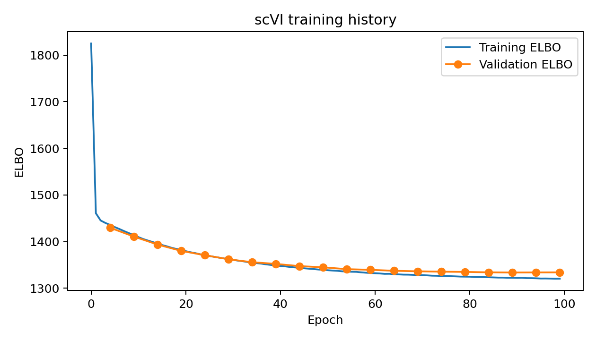
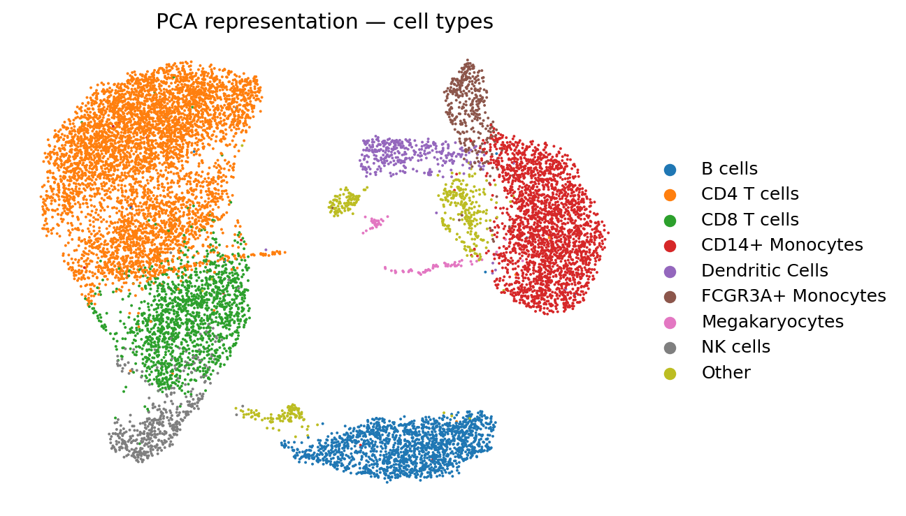
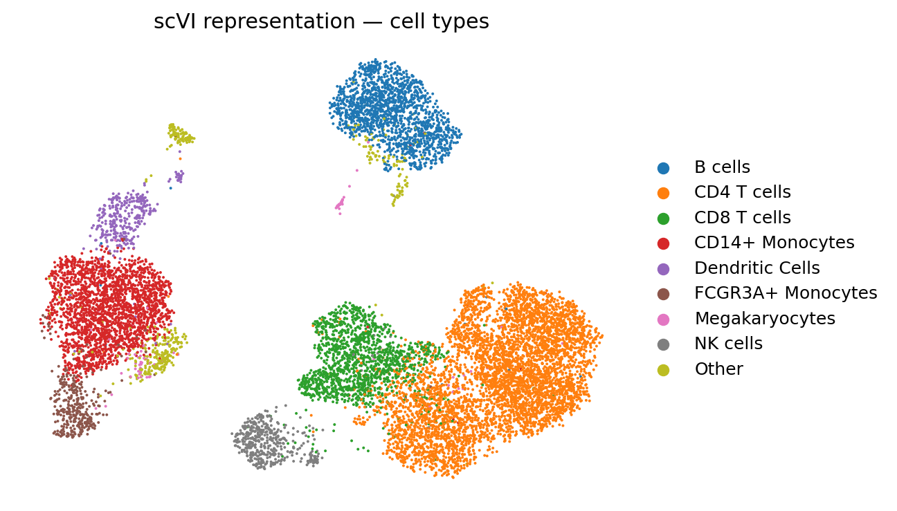
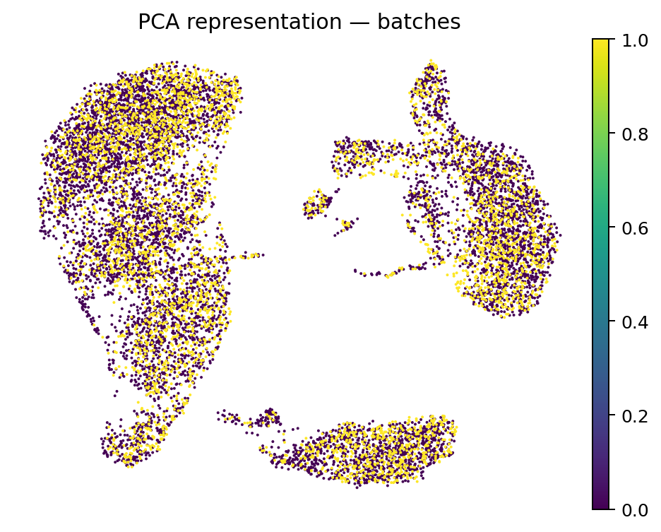
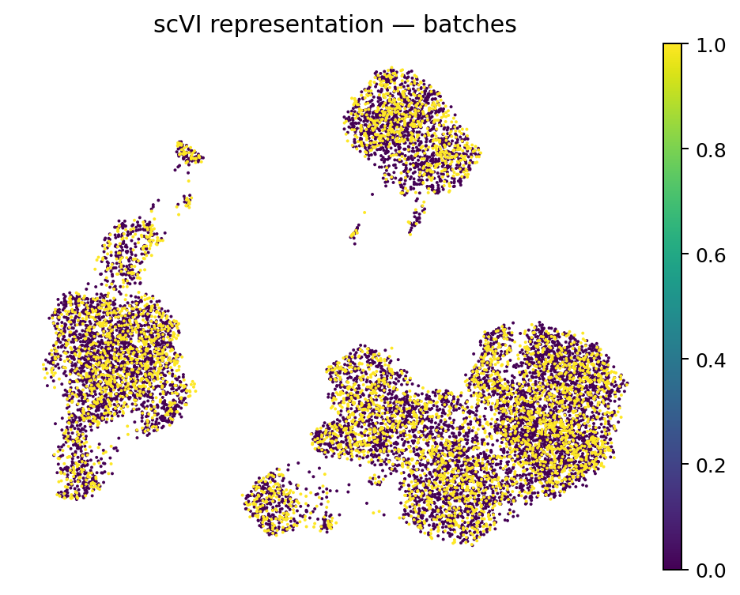

# PCA and scVI representations of human PBMC single-cell RNA-seq data

This project compares a standard linear representation (**PCA**) with a probabilistic generative model (**scVI**) on an annotated human peripheral blood mononuclear cell (PBMC) single-cell RNA-seq dataset.

The project was developed to extend my background in mathematical statistics, machine learning and PyTorch to biological data. The aim is not to assume that the more complex model is better, but to examine the trade-off between preserving biological cell-type structure and reducing technical batch structure.

## Research question

**How do PCA and scVI differ in their ability to preserve annotated immune-cell structure while mixing two technical batches in human PBMC single-cell RNA-seq data?**

## Data

The analysis uses the PBMC dataset distributed through `scvi-tools`.

The final dataset contains:

- 11,990 cells;
- 3,346 genes;
- two technical batches;
- nine annotated cell populations:
  - B cells;
  - CD4 T cells;
  - CD8 T cells;
  - CD14+ monocytes;
  - dendritic cells;
  - FCGR3A+ monocytes;
  - megakaryocytes;
  - NK cells;
  - other cells.

The data are downloaded automatically in the notebook and are not committed to this repository.

## Methods

### PCA baseline

Raw counts were retained for scVI. For PCA, expression values were library-size normalised, log-transformed and scaled. The first 10 principal components were used as the PCA representation.

### scVI

scVI was fitted to raw gene-expression counts with:

- technical batch supplied as a covariate;
- a 10-dimensional latent space;
- two hidden layers;
- 128 hidden units;
- a negative-binomial likelihood;
- up to 100 training epochs.

### Evaluation

The two 10-dimensional representations were compared using:

1. **Cell-type silhouette score** — higher values indicate stronger separation of annotated cell types.
2. **5-fold cross-validated kNN balanced accuracy** — higher values indicate that known cell-type labels are easier to recover from the representation.
3. **Global absolute batch silhouette score** — values closer to zero indicate weaker global batch separation.
4. **Within-cell-type absolute batch silhouette score** — values closer to zero indicate better mixing of batches after conditioning on biological cell type.
5. UMAP visualisations coloured by cell type and technical batch.

## Results

| Representation | Cell-type silhouette ↑ | kNN balanced accuracy ↑ | Global batch silhouette ↓ | Within-cell-type batch silhouette ↓ |
|---|---:|---:|---:|---:|
| PCA | 0.3991 | 0.9417 ± 0.0159 | 0.0060 | 0.0102 |
| scVI | 0.2084 | 0.8844 ± 0.0123 | 0.0049 | 0.0039 |

### Biological structure

PCA preserved the supplied cell-type labels more strongly in this dataset. Its cell-type silhouette score was **0.3991**, compared with **0.2084** for scVI, and its 5-fold cross-validated kNN balanced accuracy was **0.9417**, compared with **0.8844** for scVI.

The UMAPs are consistent with this result: the PCA representation shows cleaner separation of several annotated populations, while some related populations overlap more strongly in the scVI latent space.

### Batch mixing

scVI showed lower batch separation on both batch metrics. The global absolute batch silhouette decreased from **0.0060** for PCA to **0.0049** for scVI. More importantly, the weighted within-cell-type batch silhouette decreased from **0.0102** to **0.0039**.

The within-cell-type batch silhouette was lower for scVI in all nine annotated cell groups. This suggests that scVI improved technical batch mixing, although PCA retained the annotated biological labels more distinctly.

### Main interpretation

The final analysis does **not** support a simple conclusion that one representation is universally better.

Instead, it shows a trade-off:

- **PCA better preserved the supplied cell-type structure.**
- **scVI better mixed the two technical batches within cell types.**

This is useful because batch correction should not be assessed independently of biological signal. A representation that removes technical variation can also alter biologically meaningful structure, so both objectives need to be considered together.

## Training diagnostics

The scVI training and validation evidence lower bound (ELBO) decreased substantially during training. Validation ELBO reached its lowest observed value around epoch 89 and then remained close to that level through epoch 100, suggesting that the optimisation had largely stabilised.



## UMAP visualisations

### Cell-type structure

| PCA | scVI |
|---|---|
|  |  |

### Technical batch

| PCA | scVI |
|---|---|
|  |  |

## Repository structure

```text
single-cell-pbmc-pca-scvi/
├── README.md
├── requirements.txt
├── .gitignore
├── notebooks/
│   └── 01_pbmc_pca_vs_scvi.ipynb
└── results/
    ├── representation_metrics.csv
    ├── batch_mixing_by_cell_type.csv
    ├── training_history.csv
    ├── software_versions.csv
    ├── scvi_training_curve.png
    ├── umap_pca_cell_types.png
    ├── umap_pca_batch.png
    ├── umap_scvi_cell_types.png
    └── umap_scvi_batch.png
```

## Reproducibility

The analysis was run with a fixed random seed (`42`). Package versions used in the completed run are recorded in `results/software_versions.csv`.

To reproduce the analysis, open the notebook in Google Colab, select a GPU runtime if available, and run all cells from top to bottom.

## Limitations

- The dataset is a standard PBMC benchmark and does not represent the complexity of developmental or disease tissue.
- Cell-type labels are treated as reference annotations for evaluation.
- The analysis compares only one PCA specification and one scVI specification; it is not a comprehensive model benchmark.
- The interpretation of batch removal depends on the assumption that batch-associated differences within labelled cell types are primarily technical.
- UMAP is used for visualisation only and should not be treated as a quantitative measure of model quality.
- Better latent-space separation does not establish biological mechanism or causality.

## Tools

Python, PyTorch, scvi-tools, Scanpy, NumPy, Pandas, scikit-learn and Matplotlib.

## References

- Lopez, R. et al. (2018). *Deep generative modeling for single-cell transcriptomics*. **Nature Methods**, 15, 1053–1058.
- scvi-tools documentation: https://docs.scvi-tools.org/
- Scanpy documentation: https://scanpy.readthedocs.io/
